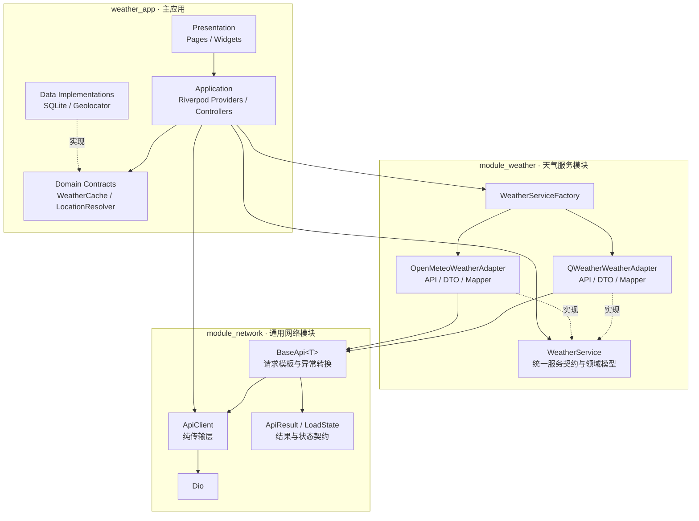
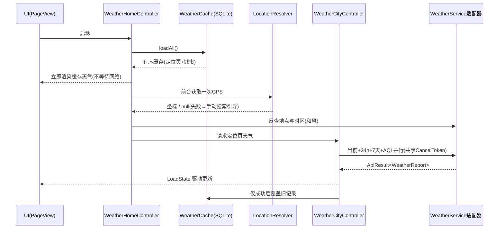
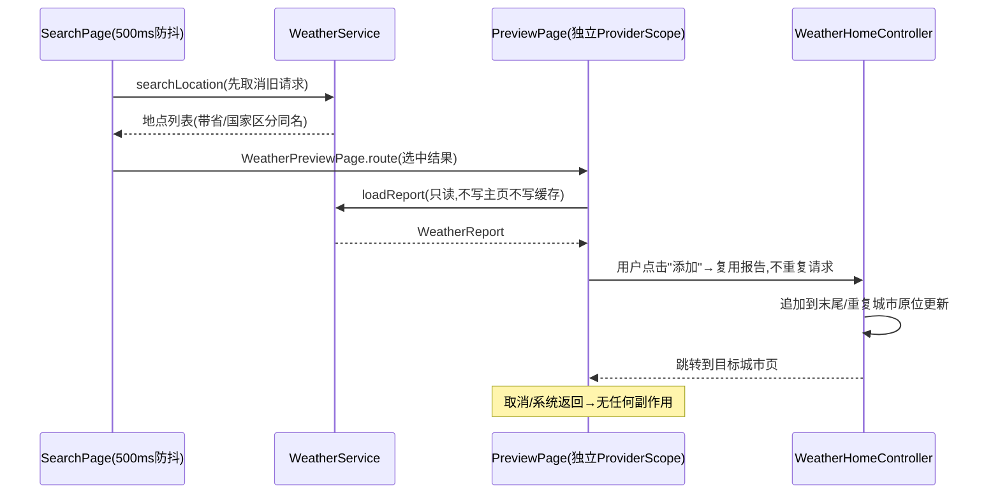

# Weather App

一个使用 Flutter 编写的天气应用，支持当前定位、多城市管理、地点搜索、当前天气、24 小时分时预报、7 天预报、语言/主题设置和轻量天气动画。天气数据默认来自和风天气，也可在设置页切换为无需 API KEY 的 Open-Meteo。

## 亮点速览

- **三工程模块化架构**：`module_network`（通用网络基础层）、`module_weather`（天气服务适配层）、主应用各司其职，依赖方向单向，两个子包均为可独立测试、可复制到其他项目的 Dart package。
- **一套统一契约接入两个真实服务商**：和风天气与 Open-Meteo 通过适配器实现同一个 `WeatherService`，设置页即时切换服务，不清空城市、顺序与旧天气。
- **222 个自动化测试全部通过**（`module_network` 20 + `module_weather` 73 + 主应用 129），静态检查零问题；不依赖真实凭据、设备定位或天气 API 即可复现。
- **完整的错误工程**：和风官方 18 个错误码、Open-Meteo 官方错误结构全部显式分类映射；密封 `ApiResult` 从传输层贯穿到 UI；不向界面泄漏原始响应、密钥或坐标。
- **竞态与取消双保险**：`CancelToken` 真正中断传输 + 请求版本号隔离过期结果，覆盖搜索防抖、服务切换、多城市刷新与页面销毁等全部并发场景。
- **克制的隐私边界**：仅前台一次性低精度 GPS，无 IP 定位、无后台定位；SQLite 只存天气缓存，API 凭据仅通过编译期环境变量注入，不入库。

## 技术栈

| 类别 | 选型 | 说明 |
| --- | --- | --- |
| 框架 | Flutter **3.35.4** / Dart **3.9.2** | 通过 `.fvmrc` 锁定版本 |
| 状态管理 | `flutter_riverpod` | `Notifier` + 不可变状态 + `autoDispose.family` |
| 网络 | `dio` | 经 `module_network` 封装，UI 不直接接触 |
| 序列化 | `json_serializable` + `build_runner` | DTO 生成代码入库，可复现 |
| 存储 | `sqflite` / `shared_preferences` | 天气缓存 / 用户设置各司其职 |
| 定位 | `geolocator` | 仅前台一次性低精度定位 |
| 刷新 | `easy_refresh 3.x` | 每城市独立下拉刷新 |
| 图标/动画 | `qwd Icons` 官方 SVG + `flutter_svg` | 内置轻量缩放，可降级静态图 |
| 国际化 | `flutter_localizations` + `intl` + `gen-l10n` | ARB 双语源文件 |

## 功能

- **当前定位**：前台获取 GPS 并展示当前位置天气；定位不可用时提供手动搜索引导。
- **多城市天气**：左右滑动切换城市，定位页固定在第一页，其余城市按添加或手动排序展示。
- **城市搜索与预览**：按城市名称搜索，先预览完整天气，再决定是否添加；重复城市自动更新而非重复添加。
- **完整天气信息**：当前天气、空气质量、体感温度、湿度、降水、风速、24 小时分时预报和 7 天预报。
- **本地缓存与刷新**：冷启动优先展示最近天气，后台更新数据；支持下拉刷新，网络失败时保留已有内容。
- **城市管理**：删除城市、拖拽排序，并同步主页、分页指示器和本地缓存。
- **天气服务切换**：默认使用和风天气，可切换为 Open-Meteo，切换后保留已有城市和页面顺序。
- **个性化设置**：支持英文/简体中文、浅色/深色/跟随系统主题，以及定位权限管理和数据来源说明。
- **天气视觉与状态反馈**：iOS 天气风格分页、悬浮城市标题、官方 SVG 天气图标和轻量动画；完整处理加载、空结果、错误与重试状态。

## 环境要求

- Flutter **3.35.4**（stable）
- Dart **3.9.2**
- Android 或 iOS 目标环境
- 使用默认和风服务时，需要和风控制台中已创建的项目、API KEY 和项目专属 API Host；Open-Meteo 非商业公共服务模式不需要 KEY。

## 安装与运行

默认服务是和风天气。在项目根目录创建 `qweather.local.json`（该文件已在 `.gitignore` 中排除）：

```json
{
  "QWEATHER_API_HOST": "https://your-api-host",
  "QWEATHER_API_KEY": "your-api-key"
}
```

然后执行：

```bash
flutter pub get
flutter gen-l10n
flutter run --dart-define-from-file=qweather.local.json
```

`QWEATHER_API_HOST` 必须填写控制台为项目分配的完整 HTTPS API Host，不能直接使用文档里的 `your-api-host` 占位符。真实 KEY 只保存在本地忽略文件中，并通过 `--dart-define-from-file` 注入；不要写入源码、README、Shell 历史或 Git。Android Studio 的 `main.dart` 启动项已在 `.idea/runConfigurations/main_dart.xml` 配置该文件；VS Code 请选择 **Weather App (QWeather)** 启动项。两者都需要完全停止后重新运行，热重载不会改变编译期配置。未配置凭据时使用和风会显示明确的配置错误，而不是普通数据解析错误。

仅使用 Open-Meteo 时可直接执行 `flutter pub get && flutter run`，启动后进入设置页把天气服务切换为 Open-Meteo。服务选择保存在 SharedPreferences，下次启动继续使用；Open-Meteo 请求不会携带和风 KEY。两家服务需要可访问各自官方 HTTPS API 的网络环境。

修改天气 DTO 后，在 `module_weather/` 目录重新生成并检查入库的 `*.g.dart`：

```bash
dart run build_runner build --delete-conflicting-outputs
```

iOS 模拟器即使已经授权定位，也必须提供模拟坐标才能返回位置。可在模拟器菜单 **Features → Location** 选择位置，或执行 `xcrun simctl location booted set 30.5928,114.3055`；未设置时可能只显示定位中，应用在兜底超时后会提示检查定位服务和权限。

`*.g.dart` 和 gen-l10n 生成文件均保留在源码中，因此正常拉取代码后无需先执行生成器即可分析。修改 DTO 或 ARB 后，需要重新执行对应生成命令并检查生成差异。

## 架构

项目采用 **"按能力拆包 + 主应用按职责分层"** 的模块化架构。设计重点不是增加层次，而是建立四条清晰的边界：

1. **界面不接触 HTTP 和原始 JSON**——Widget 只根据状态渲染，数据获取全部在应用层协调。
2. **业务不依赖具体天气服务商**——主应用只面对 `WeatherService` 统一契约。
3. **通用网络代码不包含天气概念**——`module_network` 与业务彻底解耦，可整体复用。
4. **外部依赖皆可替换**——网络、定位、存储、服务都通过接口或 Provider 注入，测试全部使用内存实现与可控 Fake。

### 整体结构



核心依赖方向固定为 **`weather_app → module_weather → module_network`**，两个子模块都不得反向导入主应用。主应用还直接使用 `module_network` 的传输、错误和状态契约。

### 工程与目录结构

```text
weather_app/
├── lib/                                  # 主应用
│   ├── main.dart / app.dart               # 入口与根 Widget
│   ├── features/
│   │   ├── weather/                      # 天气核心业务
│   │   │   ├── application/              # Riverpod 组合根 + 4 个 Controller + 状态对象
│   │   │   ├── data/                     # SQLite 缓存、报告编解码、Geolocator 定位实现
│   │   │   ├── domain/                   # WeatherCache / LocationResolver 抽象
│   │   │   └── presentation/             # 5 个页面 + 10 个复用 Widget + 动画 + 格式化
│   │   └── settings/                     # 设置业务，同样四层
│   │       ├── application/  data/  domain/  presentation/
│   └── l10n/                             # ARB 源文件 + gen-l10n 生成物
│
├── module_network/                       # 通用网络基础层（无业务概念的 Dart 包）
│   ├── lib/
│   │   ├── network/                      # ApiClient / BaseApi / ApiResult / CancelToken
│   │   ├── models/                       # JsonModel 基类 + ModelDecoder
│   │   ├── error/                        # AppException 异常体系
│   │   └── state/                        # LoadState<T> 加载状态契约
│   └── test/                             # 独立测试 + 自包含 Fake Dio 适配器
│
├── module_weather/                       # 天气服务适配层（不含 UI / Riverpod / 平台插件）
│   ├── lib/
│   │   ├── models/                       # 统一领域模型 Location / WeatherReport / WeatherCondition
│   │   ├── weather_service.dart          # 统一服务契约
│   │   ├── weather_service_factory.dart  # 服务工厂
│   │   ├── weather_provider.dart         # 服务商枚举
│   │   ├── weather_exception.dart        # 配置缺失业务异常
│   │   └── src/                          # 服务商实现细节，不对主应用公开
│   │       ├── qweather/                 # 和风：config / error / api×6 / dto×5 / mapper / adapter
│   │       └── open_meteo/               # Open-Meteo：error / api×4 / dto×3 / mapper / adapter
│   └── test/
│       ├── contract/                     # 两家服务跑同一套统一契约测试
│       ├── qweather/  open_meteo/        # 各自 DTO / mapper / adapter / 错误结构测试
│       └── fixtures/  helpers/           # 本地 JSON fixture 与自包含测试辅助
│
├── integration_test/ + test_driver/      # 双服务真实在线驱动与冷启动恢复验证
└── assets/weather_icons/                 # qwd 官方 SVG 图标 + MIT 许可证
```

### module_network —— 通用网络基础层

一个与天气完全无关的可复用 Dart 包：生产代码只依赖 `dio` 和 `json_annotation`，不绑定 Riverpod，不创建全局单例。任何 Dart/Flutter 项目都可以通过 `module_network: path: ./module_network` 接入。

| 文件 | 职责与边界 |
| --- | --- |
| `network/api_client.dart` | **纯传输层**。`request`/`get`/`post` 只返回原始 Dio `Response`，不解析 JSON 模型、不处理业务状态码——保证最底层可被任何上层策略复用。 |
| `network/base_api.dart` | **模板方法**。固定发送 → 状态码判断 → 业务错误识别（`mapErrorResponse`）→ 异常转换的流程；子类只声明 URI、参数、请求头、decoder、成功状态码。 |
| `network/api_result.dart` | **密封结果类型**。`Success<T>`/`Failure<T>` 携带模型与可选 HTTP 状态码；`fromResponse` 统一 429 限流与解析失败的状态码保留规则。 |
| `network/cancel_token.dart` | 取消令牌薄封装，一次取消可中断共享同一令牌的并发请求组。 |
| `models/json_model.dart` | 所有模型的基类契约：`toJson` + 协变返回类型的 `copyWith`；`ModelDecoder<T>` 让 decoder 可注入（Dart 静态构造不能继承，避免伪统一 `fromJson`）。 |
| `error/app_exception.dart` | 六类业务异常：Network / Timeout / RateLimit / Http / Data / Config，UI 按类型映射国际化文案。 |
| `state/load_state.dart` | **UI 加载状态契约**。`LoadStatus` 五态（idle/loading/empty/success/error）+ 可空 data/exception/statusCode；`fromResult` 是 Result → State 的唯一转换入口，Controller 不得复制第二套映射。 |

### module_weather —— 天气服务适配层

把"两家服务商的差异"整体关进模块内部。公开层只暴露统一契约与领域模型；每家服务商的 API、DTO、mapper、配置和错误结构全部位于 `src/` 内部，主应用不可见。

**公开层（主应用唯一可见部分）**

| 文件 | 职责 |
| --- | --- |
| `weather_service.dart` | 统一服务契约：城市搜索、完整天气报告、来源声明——所有代码面向它编程。 |
| `models/weather_report.dart` 等 | 统一领域模型 `Location` / `WeatherReport` / `WeatherCondition`；每份报告保留实际 `provider` 用于来源展示与缓存兼容。 |
| `weather_service_factory.dart` | 按 `WeatherProviderType` 创建适配器的唯一入口。 |
| `weather_exception.dart` | `AppConfigException`：凭据缺失在请求发出前即可诊断。 |
| `qweather_error.dart` / `open_meteo_error.dart`（经公开入口导出） | 服务商官方错误结构到统一异常的映射，供 UI 分类提示。 |

**内部实现 —— 每家适配器固定四件套**

| 组成 | 和风（`src/qweather/`） | Open-Meteo（`src/open_meteo/`） |
| --- | --- | --- |
| 配置/错误 | `QWeatherConfig`（编译期环境变量注入 Host/KEY）+ `QWeatherErrorCode`（官方 18 个错误码枚举） | `open_meteo_error.dart`（`{"error":true}` 结构识别，`reason` 不外泄） |
| API 层 | `QWeatherApi` 基类 + 城市搜索/当前/小时/每日/空气质量 5 个具体 API | `OpenMeteoApi` 基类 + Geocoding/Forecast/AirQuality 3 个具体 API |
| DTO 层 | 5 个 `json_serializable` DTO（`*.g.dart` 入库可复现） | 3 个 DTO，覆盖一次 Forecast 返回当前+24h+7 天 |
| Mapper + 适配器 | 单位换算（m/s→km/h、0–1→%）、天气代码本地化、时区处理 | WMO 代码映射、US AQI 六档、并行数组校验 |

两家适配器的编排差异也被显式建模：和风 GPS 先反查地点/时区再 4 接口并行；Open-Meteo 无反向地理编码，直接按坐标请求 Forecast 由响应补全时区，城市缺失时显示"当前位置"而不虚构。`test/contract/` 中两家服务运行**同一套契约测试**，保证适配器对外行为真正等价。

### 主应用 —— 按功能与职责分层

每个 feature 内部保持 presentation → application → domain ← data 的单向依赖：

| 分层 | 位置 | 职责与边界 |
| --- | --- | --- |
| 展示层 | `features/*/presentation/` | 只负责布局、交互、语义和根据 `LoadStatus` 渲染分支；不创建 Dio、不解析 JSON、不读写数据库。 |
| 应用层 | `features/*/application/` | Riverpod 组织依赖注入与用例状态：`providers.dart` 是组合根，Controller 协调加载、刷新、取消、竞态与页面顺序。 |
| 领域契约 | `features/*/domain/` | 定义 `WeatherCache`、`LocationResolver`、`SettingsRepository` 抽象；天气数据契约直接复用 `module_weather` 的统一模型，不重复造一层。 |
| 数据实现 | `features/*/data/` | `sqflite_weather_cache` + `WeatherReportCodec`（完整报告编解码）、`Geolocator` 定位实现、SharedPreferences 设置存储；不包含界面状态。 |

`WeatherRepository` 目前只是 `WeatherService` 的**类型别名**，用于保留应用层熟悉的命名。这是一个有意的取舍：抽象只放在真正存在替换需求的位置（缓存、定位、存储都有平台实现需要替换，而天气服务已有 `WeatherService` 契约），避免为了"标准架构"写一层无职责的转发。

`module_weather` 和 `module_network` 是仓库内的独立 path package，不依赖 Flutter UI、Riverpod、设备定位或 SQLite，可以单独测试，也能复制到其他 Dart/Flutter 项目。采用单仓库管理而不是发布多个远端包，是为了让调用方、适配器和基础层可以在同一次评审中被完整阅读，同时保持模块边界真实存在。

### 设计模式一览

| 设计模式 | 项目中的实现 | 解决的问题 |
| --- | --- | --- |
| **适配器模式** | `QWeatherWeatherAdapter`、`OpenMeteoWeatherAdapter` 实现同一个 `WeatherService` | 两家服务的 URL、字段、天气代码、地点 ID、时区和空气质量标准完全不同；适配器内部完成差异化处理，对外始终返回相同契约。新增服务商时主应用零修改。 |
| **抽象工厂 / 工厂方法** | `WeatherServiceFactory.create(WeatherProviderType)` | 把"创建哪个服务"集中到一处；Controller 不实例化具体适配器，设置页切换服务即运行时驱动工厂。 |
| **模板方法模式** | `BaseApi<T>` 固定发送、状态码处理、异常转换流程；子类只声明配置，必要时重写 `mapErrorResponse` 识别业务错误（如和风 `no-such-location`→空结果） | 每个 API 不再重复写 Dio 调用和异常处理，同时保留明确的扩展点。 |
| **DTO + Mapper（防腐层）** | 服务商 DTO 只描述各自 JSON，mapper 统一转为 `Location`/`WeatherReport` | 上游字段变化只影响对应 DTO/mapper；Widget 永远不接触 `dynamic` 或原始响应，API 字段无法泄漏到整个应用。 |
| **仓储 / 网关抽象** | `WeatherCache`、`LocationResolver`、`SettingsRepository` 隔离 SQLite、Geolocator、SharedPreferences | 业务状态不依赖平台 API；测试注入内存实现，无真实定位、数据库文件和网络也能验证核心逻辑。 |
| **依赖注入 + 观察者** | Riverpod Provider 注入 Dio、服务与存储；Widget 用 `ref.watch` 订阅不可变状态、事件回调用 `ref.read` | 依赖关系显式、生命周期可管理、测试可覆盖；服务切换使旧 Provider 失效并重建实例，不需要全局可变单例。 |
| **密封类穷尽匹配** | `ApiResult` 的 `Success/Failure`、`LoadStatus` 五态 + Dart 3 穷尽 `switch` | 结果与 UI 状态分开建模，杜绝多个布尔值组合出矛盾状态；新增分支时编译器强制处理，不会静默漏掉一种情况。 |
| **错误分类映射** | 和风 18 个官方错误码枚举 + Open-Meteo 错误结构 → 三类用户提示（限流/凭据额度/服务错误） | 服务端错误对用户可理解、对开发可诊断，且不暴露 `detail`、`invalidParams`、状态码原文或凭据。 |
| **优雅降级** | 空气质量失败只显示 `--`；单条缓存损坏只跳过该条；定位失败保留旧天气 + 手动搜索引导 | 非关键路径的失败不破坏核心成功状态，页面永远可用可恢复。 |
| **Cache-First + 后台刷新** | 启动先读 SQLite 立即展示，网络成功才覆盖缓存 | 慢网/无网仍有内容可看；不会把旧数据误标为本次刷新成功。 |

适配器统一的是**应用需要的语义**，不是宣称两家服务的数据完全等价。观测模型、地名和空气质量标准仍可能不同；每份 `WeatherReport` 都保留实际 `provider`，用于来源展示、缓存兼容和跨服务身份处理。

### 状态归属与 Controller 拆分

项目没有用一个全局 Controller 包办所有业务，而是按状态所有权拆分，每个 Controller 只能修改自己拥有的状态：

| Controller | 拥有的状态与职责 |
| --- | --- |
| `WeatherHomeController` | 有序城市列表、固定定位页、当前选中页、定位阶段；协调缓存恢复、添加、删除、排序和可见页刷新。 |
| `WeatherCityController` | 一个稳定城市 key 对应的 `LoadState<WeatherReport>`；负责该城市请求、取消和刷新，通过 `autoDispose.family` 管理生命周期。 |
| `SearchController` | 搜索关键词、校验、结果列表、500ms 防抖后的请求状态和取消；离开搜索页自动释放。 |
| `WeatherPreviewController` | 独立预览页的天气加载状态；只读天气服务，不修改主页或缓存。 |
| `SettingsController` | 语言、主题和天气服务的即时更新与持久化；定位权限仍以操作系统返回的真实状态为准。 |

主页保存城市顺序和最新报告快照，单城市 Controller 负责网络状态。这样既能让 `PageView` 在页面重建后快速恢复内容，又能避免一个城市刷新导致所有城市一起重发请求。不可见城市继续保留旧报告，只有实际可见或明确刷新时才消耗天气 API 配额。

### 核心数据流

**冷启动与定位刷新**



**搜索 → 预览 → 添加**



**服务或语言切换**：设置变化通过 Riverpod 使旧天气服务失效，工厂创建新适配器。定位页、城市列表和当前页保持不变；旧请求被取消且旧响应不能写回。只刷新定位页和当前可见城市，其余页面保留内容并按需更新。

统一的数据转换路径始终是：

```text
HTTP JSON → DTO → Mapper → WeatherReport → ApiResult<T> → LoadState<T> → Widget
                                            └─ 成功后更新主页快照与 SQLite
```

### 请求取消与竞态处理

仅"忽略旧结果"不能减少已经发出的 HTTP 请求，因此项目同时使用两层保护：

- **真正取消传输**：`ApiClient`/`BaseApi` 透传 `CancelToken`。同一份天气报告的当前天气、预报和空气质量并行请求共享令牌，一次取消全部中断。
- **结果版本隔离**：Controller 使用递增 `requestId`。新搜索、重试、服务切换、接受新报告或 Provider 销毁时使旧编号失效，即使旧 Future 在取消后仍返回，也不能覆盖新状态或写入缓存。

取消异常统一转换为无 HTTP 状态码的 `Failure`；由于请求编号已失效，它不会再触发可见错误。搜索还结合输入防抖和相同加载关键词去重，减少无意义请求。

### 缓存身份与一致性

- 定位页固定使用 `current`，城市使用主应用分配且跨服务稳定的 `Location.clientId`，不直接混用两家服务商的地点 ID。
- 同服务按服务方 ID 判重，跨服务使用小范围坐标容差辅助判重；更新城市时保留原页面身份和排序位置。
- SQLite 以 `page_key + position` 保存身份与顺序；删除后压缩位置，拖拽排序在事务内更新，写入串行执行。
- 单条缓存损坏只跳过该记录；数据库版本升级自动迁移旧数据。读取、写入或删除异常都不会清空当前可用天气。
- `WeatherReportCodec` 负责完整报告编解码，避免数据库字段与界面模型到处互相转换。

### 错误边界与可测试性

- **传输边界**：`ApiClient` 只返回原始 Dio `Response`，不知道业务模型；`BaseApi` 将网络、超时、HTTP 和解析异常转换为统一结果。
- **服务商边界**：两家服务的官方错误协议都被显式解析——和风按 RFC 7807 `error.type` 识别 18 个官方错误码，Open-Meteo 识别 `{"error":true,"reason":...}` 结构；限流类映射为限流提示，和风凭据/额度类映射为"检查 API 密钥、Host 或账户额度"，其余按服务错误展示；无法识别的结构回退通用 HTTP 错误，任何分支都不向界面泄漏 `detail`、`invalidParams`、`reason`、状态码原文或凭据。
- **界面边界**：UI 只根据 `LoadStatus` 和可国际化的错误类型展示反馈，不显示堆栈、原始响应或密钥。
- **模块级测试**：`module_network` 使用可控 Dio adapter；`module_weather` 使用本地 fixture，并对两家服务商运行同一套契约测试。
- **应用级测试**：通过 Provider 覆盖注入 Fake 服务、定位和存储，验证加载、空结果、失败、重试、取消、竞态、多城市与缓存恢复，而不是只测试 Widget 能否创建。

## 数据服务与限制

两家服务都通过 `WeatherService` 提供相同的搜索与完整天气报告，但观测/预测模型、地理编码能力和空气质量标准并不完全等价。统一切换不代表同一时刻的数值必然一致。

### 和风天气 QWeather

- 城市搜索：`GET /geo/v2/city/lookup`，参数为 `location`、`number=20`、`lang`。
- 当前天气：`GET /weather/v1/current/{latitude}/{longitude}`。
- 小时预报：`GET /weather/v1/hourly/{latitude}/{longitude}?hours=24`。
- 每日预报：`GET /weather/v1/daily/{latitude}/{longitude}?days=7`。
- 实时空气质量：`GET /airquality/v1/current/{latitude}/{longitude}`；优先当地 `cn-mee`/`us-epa`，最后回退 `qaqi`，显示 `aqiDisplay + category`。
- 凭据通过 `X-QW-Api-Key` 请求头发送，天气路径中的经纬度统一保留两位小数。
- 错误响应按官方错误码表解析（RFC 7807 `problem+json` 的 `error.type`/`error.title`）：`no-such-location` 映射为空结果，`too-many-requests`/`over-monthly-limit` 映射为限流提示，`unauthorized`/`invalid-host`/`no-credit`/`overdue`/`security-restriction`/`account-suspension` 映射为"检查 API 密钥、Host 或账户额度"的配置类提示，其余错误码保持通用服务错误；无法识别的结构回退为普通 HTTP 错误，界面不展示 `detail`、`invalidParams`、状态码或凭据。
- GPS 地点先按页面语言通过 GeoAPI 反查城市、时区和 UTC 偏移，再并行请求当前、小时、每日天气和空气质量；已搜索城市保留时区信息，一次天气刷新使用 4 次请求，GPS 刷新额外使用 1 次 GeoAPI 请求。
- 湿度和降水概率由 0–1 转为百分比，风速由 m/s 转为 km/h；天气代码映射到应用内国际化文案和动画。
- 搜索预览和设置页显示实际服务及官方 attribution 地址，首页不重复显示。不建立城市索引或地理数据库，只保存定位页和用户添加城市的天气报告。
- 免费额度与计费以控制台及官方价格页为准；官方按量计费说明提供每月前 50,000 次请求免费额度，并非每日 50,000 次。
- 官方文档：https://dev.qweather.com/docs/api/
- 价格说明：https://dev.qweather.com/docs/finance/pay-as-you-go/

### Open-Meteo

- 城市搜索：`GET https://geocoding-api.open-meteo.com/v1/search`，最多返回 20 条。
- 天气：`GET https://api.open-meteo.com/v1/forecast`，一次返回当前、24 小时和 7 天数据，显式请求 °C、km/h、mm 和 `timezone=auto`。
- 空气质量：`GET https://air-quality-api.open-meteo.com/v1/air-quality`，使用 US AQI 六档类别。
- WMO 天气代码映射到统一 `WeatherCondition`；未知代码显示未知天气，不伪造具体状况。小时/每日并行数组必须等长、数量正确且时间连续。
- Geocoding 不提供和风式 GPS 反向城市查询，因此定位页直接按 GPS 坐标请求 Forecast，由响应补全时区；没有地名时显示"当前位置"，不回调和风或虚构城市。
- 核心天气请求失败会显示错误；空气质量请求或数据不可用时只显示 `--`。
- 错误响应按官方 Errors 章节约定解析：非 2xx 响应体为 `{"error": true, "reason": "..."}`（Open-Meteo 没有和风式的错误码枚举），HTTP 400 为参数错误、404 为路径不存在、429 映射为通用限流提示，其余服务端确认的错误按通用服务错误展示；`reason` 是面向开发者的诊断字符串、可能回显请求参数，不写入异常 message，不向界面或日志泄漏。
- 非商业公共服务模式不需要 KEY，首版不支持商业 customer Host/凭据。使用限制、署名和服务条款以官方页面为准。
- 官方文档：https://open-meteo.com/en/docs
- 地理编码：https://open-meteo.com/en/docs/geocoding-api
- 条款与署名：https://open-meteo.com/en/terms

**隐私与精度：** 应用只在前台需要时读取一次 GPS，不使用 IP 定位。GPS 不可用时显示手动搜索引导，不虚构默认城市。SQLite 保存当前定位及已添加城市的坐标和完整天气；SharedPreferences 只保存语言、主题和天气服务选择，不保存 KEY、IP 地址、权限状态或搜索历史；日志不输出精确坐标。

## 定位权限

### Android

`android/app/src/main/AndroidManifest.xml` 声明：

```xml
<uses-permission android:name="android.permission.INTERNET" />
<uses-permission android:name="android.permission.ACCESS_COARSE_LOCATION" />
```

`INTERNET` 用于访问和风天气与 Open-Meteo 官方 HTTPS API——Flutter 模板只在 debug/profile 模式声明该权限（服务于热重载工具链），release 构建必须在主 manifest 显式声明，否则安装后无法访问网络。`ACCESS_COARSE_LOCATION` 只在前台获取一次低精度当前位置，不申请后台定位。

### iOS

- `NSLocationWhenInUseUsageDescription` 提供英文和简体中文说明。
- `ios/Flutter/Debug.xcconfig` 和 `Release.xcconfig` 设置 `BYPASS_PERMISSION_LOCATION_ALWAYS=1`，避免请求 Always 权限。
- 如果本机使用 Swift Package Manager 且构建系统要求显式环境变量，可执行：

```bash
BYPASS_PERMISSION_LOCATION_ALWAYS=1 flutter build ios
```

不包含 `NSLocationAlwaysUsageDescription`、后台定位或持续位置监听。

## 国际化

- ARB：`lib/l10n/app_en.arb`、`lib/l10n/app_zh.arb`。
- 配置：`l10n.yaml`，生成目录为 `lib/l10n/`。
- 生成：`flutter gen-l10n`。
- 所有按钮、提示、天气状况、错误和语义文案均使用 ARB；日期和数字通过 `intl` 格式化。
- 新增文案时同步更新两个语言文件的 key、metadata 和占位符。

## 测试与质量检查

自动化测试使用本地 fixture、Fake 和 Dio `HttpClientAdapter`，不访问真实设备定位或天气 API。分层测试结构：

| 工程与目录 | 覆盖内容 |
| --- | --- |
| `module_network/test/` | JsonModel copyWith/toJson、ApiResult 状态码保留、LoadState 全态转换、ApiClient 原始请求与令牌透传、BaseApi 默认与重写配置、明确业务错误响应扩展、无响应错误及进行中请求取消。 |
| `module_weather/test/contract/` | 两家服务商运行**同一套统一契约测试**，保证适配器对外行为等价；验证天气并行请求共享取消令牌。 |
| `module_weather/test/qweather/`、`open_meteo/` | DTO 正常/异常解析、请求头、坐标格式、24 小时连续性、7 天数量、时区与单位换算；和风 18 个官方错误码与 Open-Meteo 错误结构映射、防泄漏断言。 |
| `test/features/weather/application/` | 搜索防抖与取消、单城市加载/空/错误/重试、主页顺序与定位竞态、预览只读隔离、服务切换旧响应隔离。 |
| `test/features/weather/data/` | SQLite 多城市顺序、跨服务稳定 clientId、provider 兼容、重复城市替换、单条损坏隔离、v1 迁移和并发写入顺序。 |
| `test/features/settings/` + 组件测试 | 语言/主题/服务即时切换与持久化、固定定位页、城市首次可见刷新、设置页真实权限分支、英文/中文文案、小屏与文本放大、动画与减少动画降级。 |

分别在 `module_network/` 和 `module_weather/` 目录独立验证子包，不需要真实天气凭据或主项目文件：

```bash
flutter pub get
flutter analyze
flutter test
```

在仓库根目录验证主项目：

```bash
dart format --output=none --set-exit-if-changed lib test integration_test test_driver module_network/lib module_network/test module_weather/lib module_weather/test
flutter pub get
flutter gen-l10n
flutter analyze
flutter test
```

和风真实流程需要本地凭据：

```bash
flutter drive \
  --driver=test_driver/integration_test.dart \
  --target=integration_test/app_test.dart \
  -d <ios-device-id> \
  --dart-define-from-file=qweather.local.json
```

Open-Meteo 真实流程不需要凭据。首次驱动会从默认和风切换服务、搜索添加武汉/北京、验证预报和服务往返切换；保留应用后终止进程，再验证冷启动恢复：

```bash
flutter drive --keep-app-running \
  --driver=test_driver/open_meteo_test.dart \
  --target=integration_test/app_test.dart \
  -d <ios-device-id>
xcrun simctl terminate <ios-device-id> com.example.weatherApp
flutter drive \
  --driver=test_driver/open_meteo_cache_test.dart \
  --target=integration_test/app_test.dart \
  -d <ios-device-id>
```

## 验证记录

- 2026-11-11 Android release 构建修复与验证：主 manifest 此前缺少 `INTERNET` 权限（Flutter 模板只在 debug/profile 声明，release 安装包无法访问网络），已补充；同时补回缺失的 `proguard-rules.pro` 模板文件（R8 混淆引用，缺失导致 release 编译失败）。`flutter build apk --release` 编译成功（53.3MB，模板默认 debug 签名），合并 release manifest 确认包含 `INTERNET` 与 `ACCESS_COARSE_LOCATION`，无后台定位权限。

- 2026-11-11 和风官方错误码与 Open-Meteo 错误响应处理：`module_weather` 新增 25 个错误解析/映射测试（和风错误码 16 个 + Open-Meteo 错误结构 9 个，共 73 个），主项目错误文案映射测试覆盖两服务异常（共 129 个），三工程合计 222 个自动化测试全部通过；`flutter analyze` 无问题，`dart format` 检查通过。
- 2026-11-11 Flutter **3.35.4**／Dart **3.9.2** 兼容验证：主项目 `flutter analyze` 无问题，`flutter test` **128 个**业务单元/Widget 测试全部通过。
- `module_network/` 独立静态检查无问题，**20 个**测试全部通过；`module_weather/` 独立静态检查无问题，JSON 代码生成已复跑。三项目合计 **196 个**自动化测试通过，Android Debug APK 编译成功。
- iPhone 17 模拟器（iOS 27.2）Open-Meteo 真实在线驱动通过：单字"我"和无匹配名称"我想"均完成 Geocoding 搜索并显示"未找到匹配城市"，数字邮编被城市名称校验拦截且不误报服务不可用；使用真实 Geocoding/Forecast/Air Quality 请求搜索并添加武汉和北京，展示当前天气、24 小时和 7 天预报，再往返切换服务，城市、旧报告和分页标记保持；下拉过程截图确认刷新箭头在上方展开，城市名与天气内容同步下移且不再遮挡。
- 随后终止并重开 App，第二个真实驱动确认两座城市从 SQLite 恢复、24 小时/7 天可刷新、底部分页保留，SharedPreferences 恢复 Open-Meteo 并显示正确来源；同时验证主页无传统标题栏、设置/搜索分列底部分页器两侧，以及城市名上滑后固定在顶部。此过程修复并回归验证了"time 不是可请求变量"导致的真实 HTTP 400，以及设置加载误使启动缓存失效的竞态。
- 上述 iOS Open-Meteo 驱动使用中文和手动定位 Fake，没有注入和风 KEY；该次 iOS 流程未执行真实和风在线请求、系统权限弹窗或真实 GPS。
- 此前同型模拟器的和风直连驱动已完成武汉/北京搜索添加、预报、多城市滑动、简体中文与深色主题、城市管理拖拽/删除。这些历史记录不等同于本轮重复验证。
- QWeather Icons 的主卡片、24 小时和 7 天 SVG 渲染、`currentColor` 深色主题、昼夜映射、语义和减少动画均有自动化覆盖；小屏布局无溢出。
- Android 17（API 37）`sdk_gphone64_arm64` 模拟器验证通过：Debug APK 编译安装成功；和风真实在线驱动完成武汉/北京搜索添加、当前天气与 24 小时/7 天预报、多城市滑动、简体中文、深色主题、城市管理拖拽排序和删除。
- 同一安卓模拟器的 Open-Meteo 真实在线驱动通过单字/空结果/邮编校验、双城市预报和服务往返切换；强制停止后重开，第二段驱动确认两座城市、分页顺序和 Open-Meteo 设置均从本地恢复。安卓两段驱动同样使用手动定位 Fake，未验证真实系统权限弹窗或 GPS。

## 已知限制与非目标

- 和风请求需要项目 API Host 和 KEY；免费额度、计费和可用服务以控制台为准，超额可能产生费用或请求失败。Open-Meteo 公共服务受其可用性、条款和非商业使用限制约束。
- 两家服务只统一应用所需语义，不保证数值、地点名称、时区资料或空气质量标准完全等价；首版不提供自动故障转移、商业 Open-Meteo 凭据或按城市分别选择服务。
- 支持定位页和有序多城市缓存、城市删除与拖拽排序，但不支持收藏分组或缓存数据清理；无后台定位、持续监听、定时自动刷新、单位切换、地图、账号或后端。
- 不提供超过 24 小时的分时预报；语言只支持英文和简体中文，主题只支持系统/浅色/深色。
- 定位权限由操作系统最终控制，关闭权限会打开系统 App 设置；无缓存时 GPS 不可用只能手动搜索，不提供 IP 定位回退。
- 官方 SVG 配合轻量缩放只覆盖常见天气类别，不追求复杂粒子效果。
